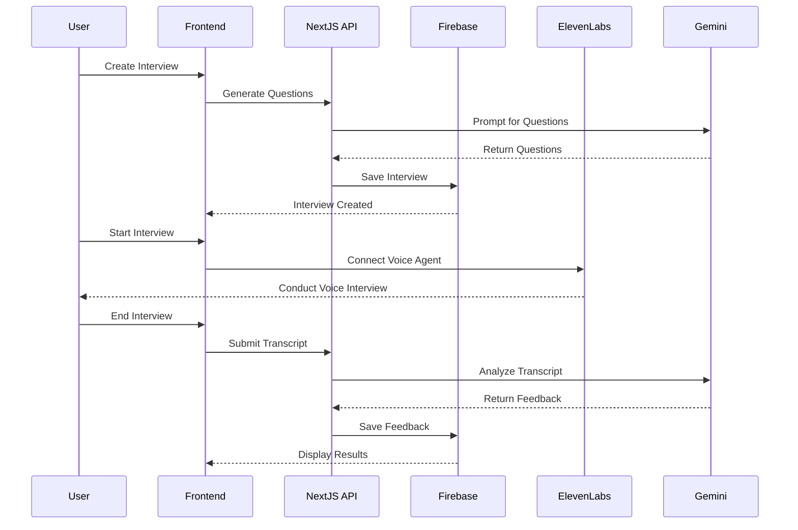

# InterviewGenie: AI-Powered Mock Interview Platform

## Project Report

---

## Table of Contents

1. [Abstract](#abstract)
2. [Introduction](#introduction)
3. [Problem Statement](#problem-statement)
4. [Motivation](#motivation)
5. [System Requirements](#system-requirements)
6. [Architecture Design](#architecture-design)
7. [Literature Review](#literature-review)
8. [Datasets / Dataset Description](#datasets--dataset-description)
9. [Gantt Chart and Project Timeline](#gantt-chart-and-project-timeline)
10. [Conclusion](#conclusion)

---

## 1. Abstract

InterviewGenie is an AI-driven interview preparation platform that simulates realistic mock interviews using ElevenLabs voice agents. The system supports both **Business (MBA)** and **Technical (CS)** interview tracks, dynamically generating tailored questions based on selected focus areas, role, and experience level.

The platform combines cutting-edge technologies including:
- **Next.js** for the frontend and backend logic
- **Firebase** for authentication and data storage
- **ElevenLabs AI** for realistic voice-based interview agents
- **Google Gemini** for intelligent question generation and feedback analysis

The system records conversations, evaluates performance across multiple dimensions (Communication Skills, Business Acumen, Analytical Thinking, Cultural Fit, and Confidence), and provides detailed feedback to help users improve their interview skills.

---

## 2. Introduction

### 2.1 Background

The modern job market has become increasingly competitive, requiring candidates to be well-prepared for interviews across various domains. Traditional interview preparation methods—such as reading books, watching videos, or practicing with friends—lack the personalized, interactive experience that can truly prepare candidates for real-world interview scenarios.

### 2.2 Project Overview

InterviewGenie is a web-based platform designed to revolutionize interview preparation by providing:

1. **Voice-based Mock Interviews**: Using ElevenLabs AI voice agents, candidates can participate in realistic, conversational interviews that mimic actual interview experiences.

2. **Intelligent Question Generation**: Google Gemini AI generates role-specific, track-appropriate interview questions based on the candidate's selected job role, experience level, and focus areas.

3. **Comprehensive Feedback System**: After each interview, the AI analyzes the conversation transcript and provides detailed feedback across multiple evaluation categories.

4. **Multi-Track Support**: The platform caters to both MBA candidates (Finance, Operations, Consulting, Marketing, Strategy) and Technical candidates (Data Structures, System Design, Programming Languages).

### 2.3 Target Audience

- MBA candidates preparing for Finance and Operations interviews
- Technical professionals preparing for software engineering interviews
- Fresh graduates entering the job market
- Career switchers aiming to practice interview skills
- Professionals seeking promotions requiring interview assessment

---

## 3. Problem Statement

### 3.1 Identified Problems

Preparing for job interviews is time-consuming and often lacks personalized feedback. Current interview preparation methods suffer from several limitations:

1. **Lack of Real-Time Interaction**: Traditional methods (books, videos) don't provide the interactive, conversational experience of actual interviews.

2. **No Personalized Feedback**: Generic preparation materials cannot evaluate individual performance or provide tailored improvement suggestions.

3. **Limited Accessibility**: Professional interview coaching is expensive and not accessible to everyone.

4. **Role-Specific Preparation Gap**: Most preparation resources are generic and don't cater to specific job roles, industries, or experience levels.

5. **Inconsistent Practice Environment**: Practicing with friends or family doesn't replicate the pressure and professionalism of real interviews.

### 3.2 Solution Requirements

An effective solution must:

- Generate role-specific, track-appropriate interview questions on demand
- Provide an interactive, voice-based interview experience that mimics real-world conversations
- Offer immediate, structured feedback on communication, technical knowledge, problem-solving, and cultural fit
- Connect users to relevant learning resources for targeted skill development
- Be accessible 24/7 and cost-effective

---

## 4. Motivation

### 4.1 Market Need

The global interview coaching market is valued at over $1 billion, indicating a significant demand for interview preparation services. However, traditional coaching methods are:

- **Expensive**: Professional interview coaches charge $100-500 per session
- **Time-Limited**: Scheduling conflicts and availability issues
- **Geographically Constrained**: Quality coaching may not be available in all regions

### 4.2 Technological Advancement

Recent breakthroughs in AI technology have made it possible to:

1. **Generate Human-Like Conversations**: Large Language Models can conduct natural, contextual conversations
2. **Synthesize Realistic Speech**: ElevenLabs and similar services provide near-human voice synthesis
3. **Analyze and Evaluate Responses**: AI can assess responses for content, structure, and delivery
4. **Provide Personalized Learning Paths**: Adaptive systems can recommend specific resources based on identified weaknesses

### 4.3 Democratization of Interview Preparation

InterviewGenie aims to:

- Make quality interview preparation accessible to everyone
- Provide unlimited practice opportunities at any time
- Offer consistent, unbiased feedback
- Reduce interview anxiety through repeated practice
- Bridge the gap between theoretical preparation and practical interview skills

---

## 5. System Requirements

### 5.1 Functional Requirements

| ID | Requirement | Description |
|----|-------------|-------------|
| FR1 | User Authentication | Users can sign up and sign in using email/password authentication |
| FR2 | Interview Creation | Users can create custom interviews by selecting role, experience level, tech stack, and question type |
| FR3 | Voice-Based Interviews | Users can conduct interviews with AI voice agents through real-time audio |
| FR4 | Question Generation | System generates role-specific questions based on user preferences |
| FR5 | Transcript Recording | System records the complete interview transcript |
| FR6 | Feedback Generation | AI analyzes transcript and provides structured feedback |
| FR7 | Dashboard | Users can view and manage all their interviews |
| FR8 | Learning Resources | System provides curated learning resources based on feedback |

### 5.2 Non-Functional Requirements

| ID | Requirement | Description |
|----|-------------|-------------|
| NFR1 | Performance | Page load time < 3 seconds |
| NFR2 | Scalability | Support 1000+ concurrent users |
| NFR3 | Availability | 99.9% uptime |
| NFR4 | Security | Secure authentication, encrypted data transmission |
| NFR5 | Usability | Intuitive UI, mobile-responsive design |
| NFR6 | Compatibility | Support modern browsers (Chrome, Firefox, Safari, Edge) |

### 5.3 Technical Requirements

#### Hardware Requirements (Client)
- Modern computer or mobile device
- Microphone for voice input
- Speakers/headphones for audio output
- Stable internet connection (minimum 1 Mbps)

#### Hardware Requirements (Server)
- Cloud-hosted infrastructure (Firebase)
- Scalable compute resources for API endpoints

#### Software Requirements
| Component | Technology | Version |
|-----------|------------|---------|
| Frontend Framework | Next.js | 16.0.4 |
| Runtime | Node.js | 20+ |
| Package Manager | npm | Latest |
| Authentication | Firebase Auth | 11.4.0 |
| Database | Firebase Firestore | 11.4.0 |
| Voice AI | ElevenLabs | 0.11.0 |
| LLM | Google Gemini | 2.0 Flash |
| Styling | Tailwind CSS | 4.0 |
| UI Components | shadcn/ui | Latest |

---

## 6. Architecture Design

### 6.1 System Architecture Overview

```
┌─────────────────────────────────────────────────────────────────────────────┐
│                              CLIENT LAYER                                    │
├─────────────────────────────────────────────────────────────────────────────┤
│  ┌──────────────────┐  ┌──────────────────┐  ┌──────────────────┐          │
│  │    Dashboard     │  │  Interview Page  │  │   Feedback Page  │          │
│  │   (React/Next)   │  │   (Voice Agent)  │  │   (Results UI)   │          │
│  └──────────────────┘  └──────────────────┘  └──────────────────┘          │
│                              │                                              │
│  ┌──────────────────────────────────────────────────────────────────────┐  │
│  │                     UI Components (shadcn/ui)                          │  │
│  │  Agent │ InterviewCard │ LearningResources │ DisplayTopicIcons        │  │
│  └──────────────────────────────────────────────────────────────────────┘  │
└─────────────────────────────────────────────────────────────────────────────┘
                                      │
                                      ▼
┌─────────────────────────────────────────────────────────────────────────────┐
│                             APPLICATION LAYER                                │
├─────────────────────────────────────────────────────────────────────────────┤
│  ┌──────────────────┐  ┌──────────────────┐  ┌──────────────────┐          │
│  │   API Routes     │  │  Server Actions  │  │    Middleware    │          │
│  │  /api/vapi/*     │  │  general.action  │  │  (Auth Check)    │          │
│  └──────────────────┘  └──────────────────┘  └──────────────────┘          │
└─────────────────────────────────────────────────────────────────────────────┘
                                      │
                                      ▼
┌─────────────────────────────────────────────────────────────────────────────┐
│                             EXTERNAL SERVICES                                │
├─────────────────────────────────────────────────────────────────────────────┤
│  ┌──────────────────┐  ┌──────────────────┐  ┌──────────────────┐          │
│  │    Firebase      │  │   ElevenLabs     │  │  Google Gemini   │          │
│  │  Auth + Firestore│  │   Voice Agent    │  │  LLM (AI SDK)    │          │
│  └──────────────────┘  └──────────────────┘  └──────────────────┘          │
└─────────────────────────────────────────────────────────────────────────────┘
```

### 6.2 Component Architecture

#### 6.2.1 Frontend Components

| Component | Purpose | Key Features |
|-----------|---------|--------------|
| `Agent.tsx` | Voice interview agent | Handles WebSocket connection to ElevenLabs, manages call state, records transcript |
| `InterviewCard.tsx` | Interview list display | Shows interview details with tech stack icons |
| `LearningResources.tsx` | Resource recommendations | Displays curated learning materials based on feedback |
| `DisplayTopicIcons.tsx` | Tech stack visualization | Renders technology icons |

#### 6.2.2 API Layer

| Endpoint | Method | Purpose |
|----------|--------|---------|
| `/api/vapi/generate` | POST | Generates interview questions using Google Gemini |

#### 6.2.3 Server Actions

| Action | Purpose |
|--------|---------|
| `createFeedback` | Generates AI feedback from interview transcript |
| `getInterviewById` | Retrieves interview details |
| `getFeedbackByInterviewId` | Retrieves feedback for an interview |
| `getLatestInterviews` | Gets recent public interviews |
| `getInterviewsByUserId` | Gets user's interview history |

### 6.3 Data Flow



### 6.4 Database Schema

#### Interviews Collection
```typescript
interface Interview {
  id: string;
  userId: string;
  role: string;           // Job role (e.g., "Finance Analyst")
  type: string;           // "Technical" | "Behavioral" | "Mixed"
  techstack: string[];    // Technologies or focus areas
  level: string;          // "Junior" | "Mid" | "Senior"
  questions: string[];    // Generated interview questions
  finalized: boolean;     // Interview completion status
  createdAt: string;      // ISO timestamp
}
```

#### Feedback Collection
```typescript
interface Feedback {
  id: string;
  interviewId: string;
  userId: string;
  totalScore: number;     // Overall score (0-100)
  categoryScores: {
    name: string;
    score: number;
    comment: string;
  }[];
  strengths: string[];
  areasForImprovement: string[];
  finalAssessment: string;
  createdAt: string;
}
```

---

## 7. Literature Review

### 7.1 AI in Interview Preparation

| Study/Product | Contribution | Relevance to InterviewGenie |
|---------------|--------------|----------------------------|
| HireVue | Video interview platform with AI analysis | Established feasibility of AI-based interview assessment |
| Pramp | Peer-to-peer technical interview practice | Highlighted need for structured interview practice |
| InterviewBit | Technical interview preparation platform | Demonstrated market demand for role-specific preparation |
| ChatGPT/Claude | Conversational AI assistants | Proved viability of AI for realistic conversation generation |

### 7.2 Voice AI Technology

The emergence of realistic voice synthesis has been transformative:

1. **ElevenLabs** - State-of-the-art voice synthesis with emotional nuance
2. **OpenAI Whisper** - High-accuracy speech-to-text conversion
3. **Google Speech AI** - Real-time speech recognition and synthesis

### 7.3 Large Language Models for Assessment

Recent research has demonstrated LLMs' capability to:

- Evaluate response quality and structure
- Identify knowledge gaps and misconceptions
- Provide constructive, actionable feedback
- Adapt assessment criteria to specific domains

### 7.4 Related Technologies Survey

| Technology | Purpose | Selection Rationale |
|------------|---------|-------------------|
| Next.js 16 | Full-stack React framework | Server components, API routes, optimal performance |
| Firebase | Backend-as-a-Service | Real-time database, authentication, easy scaling |
| ElevenLabs | Voice AI | Most natural-sounding voices, low latency |
| Google Gemini | LLM | Cost-effective, structured output support |
| Tailwind CSS | Styling | Utility-first, rapid development |

---

## 8. Datasets / Dataset Description

### 8.1 Interview Knowledge Base

InterviewGenie utilizes a curated knowledge base that categorizes interview topics and resources:

#### 8.1.1 Interview Tracks

| Track | Focus Areas |
|-------|-------------|
| Business (MBA) | Finance, Operations, Consulting, Marketing, Strategy |
| Technical (CS) | Data Structures & Algorithms, System Design, Programming Languages (Java, Python, JavaScript, C++), DevOps, Cloud, Databases |

#### 8.1.2 Question Types

| Type | Description | Example Domain |
|------|-------------|----------------|
| Technical Coding | Algorithmic problems with complexity analysis | DSA, Programming |
| System Design | High-level architecture scenarios | Scalability, Reliability |
| Technical HR | Behavioral questions for engineering roles | Team collaboration |
| Case Study | Business scenario analysis | Market sizing, Profitability |
| Behavioral | STAR-method questions | Leadership, Conflict resolution |
| Finance/Operations | Quantitative and analytical questions | Valuation, Supply chain |

### 8.2 Technology Mappings

The system maintains a mapping of technology names to their corresponding icons:

```typescript
const mappings = {
  "react": "react",
  "nextjs": "nextjs",
  "python": "python",
  "java": "java",
  "typescript": "typescript",
  // ... additional mappings
};
```

### 8.3 Learning Resources Database

| Resource | Focus | URL |
|----------|-------|-----|
| LeetCode | Coding practice | leetcode.com |
| GeeksforGeeks | DSA tutorials | geeksforgeeks.org |
| System Design Primer | System design concepts | github.com/donnemartin/system-design-primer |
| Coursera/edX | Technical & Business courses | coursera.org, edx.org |
| CLRS Book | Algorithms reference | - |
| Case in Point | Consulting interview prep | - |

### 8.4 Dynamic Question Generation

Questions are dynamically generated by Google Gemini based on:

1. **Job Role**: Specific position being interviewed for
2. **Experience Level**: Junior, Mid, or Senior
3. **Tech Stack/Focus Areas**: Relevant technologies or business domains
4. **Question Balance**: Ratio of behavioral to technical questions
5. **Question Count**: Customizable number of questions

---

## 9. Gantt Chart and Project Timeline

### 9.1 Project Phases

```
Phase 1: Planning & Design (Weeks 1-2)
├── Requirements gathering
├── Technology selection
├── Architecture design
└── UI/UX mockups

Phase 2: Core Development (Weeks 3-6)
├── Project setup (Next.js, Firebase)
├── Authentication implementation
├── Database schema design
├── Basic UI components
└── Interview creation flow

Phase 3: AI Integration (Weeks 7-9)
├── ElevenLabs voice agent integration
├── Google Gemini question generation
├── Feedback generation system
└── Transcript processing

Phase 4: Feature Completion (Weeks 10-11)
├── Dashboard implementation
├── Learning resources integration
├── UI polish and animations
└── Responsive design

Phase 5: Testing & Deployment (Weeks 12-13)
├── Unit testing
├── Integration testing
├── User acceptance testing
├── Production deployment
└── Documentation
```

### 9.2 Gantt Chart Visualization

```
Week            1   2   3   4   5   6   7   8   9   10  11  12  13
                │   │   │   │   │   │   │   │   │   │   │   │   │
Planning        ████████                                            
Core Dev            │   ████████████████                            
AI Integration          │               ████████████                
Features                │                       ████████            
Testing                 │                               ████████    
                │   │   │   │   │   │   │   │   │   │   │   │   │
```

### 9.3 Milestone Summary

| Milestone | Target Date | Deliverable |
|-----------|-------------|-------------|
| M1: Project Setup | Week 2 | Repository, environment, auth flow |
| M2: Interview Flow | Week 6 | Create and conduct interviews |
| M3: AI Integration | Week 9 | Voice agent and question generation |
| M4: Feedback System | Week 11 | Complete feedback with resources |
| M5: Production Release | Week 13 | Deployed, documented application |

---

## 10. Conclusion

### 10.1 Summary

InterviewGenie successfully addresses the critical gaps in interview preparation by leveraging cutting-edge AI technologies to create an immersive, personalized, and accessible interview practice platform. The key achievements include:

1. **Realistic Voice-Based Interviews**: Integration with ElevenLabs voice agents provides natural, conversational interview experiences that closely mimic real interviews.

2. **Intelligent Question Generation**: Google Gemini dynamically generates role-specific questions tailored to the candidate's background and target position.

3. **Comprehensive Feedback System**: AI-powered analysis evaluates candidates across multiple dimensions and provides actionable improvement suggestions.

4. **Modern Technology Stack**: Built with Next.js 16, Firebase, and modern UI frameworks ensuring performance, scalability, and excellent user experience.

### 10.2 Key Features Delivered

- ✅ Email/Password authentication with Firebase
- ✅ Custom interview creation with flexible parameters
- ✅ Real-time voice-based interview with AI agent
- ✅ Automatic transcript recording
- ✅ AI-generated structured feedback
- ✅ Dashboard for interview management
- ✅ Curated learning resource recommendations
- ✅ Responsive, modern UI design

### 10.3 Future Enhancements

| Enhancement | Description | Priority |
|-------------|-------------|----------|
| Video Analysis | Add facial expression and body language analysis | High |
| Additional Languages | Support non-English interviews | Medium |
| Interview Analytics | Track progress over time with charts | Medium |
| Group Interviews | Simulate panel interview scenarios | Low |
| Mobile App | Native iOS/Android applications | Medium |
| Resume Integration | Tailor questions based on uploaded resume | High |

### 10.4 Impact

InterviewGenie democratizes access to quality interview preparation by:

- Reducing the cost barrier to professional interview coaching
- Providing unlimited, 24/7 practice opportunities
- Offering consistent, unbiased feedback
- Enabling self-paced skill development

The platform empowers candidates to approach their interviews with confidence, equipped with practiced skills and awareness of their strengths and areas for improvement.

---

## References

1. ElevenLabs Documentation - https://elevenlabs.io/docs
2. Google AI SDK Documentation - https://ai.google.dev/
3. Firebase Documentation - https://firebase.google.com/docs
4. Next.js Documentation - https://nextjs.org/docs
5. shadcn/ui Component Library - https://ui.shadcn.com/
6. Tailwind CSS Documentation - https://tailwindcss.com/docs

---

*Report Generated: December 2024*

*Project: InterviewGenie (AI Mock Interview Platform)*
